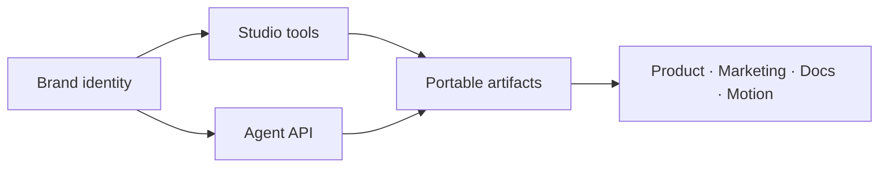

<p align="center">
  
</p>

<p align="center">
  One studio for turning a complete brand identity into motion, graphics, materials, templates, and agent-ready artifacts.
</p>

<p align="center">
  <a href="https://www.glyphfield.com/studio"><strong>Open Studio</strong></a>
  ·
  <a href="https://www.glyphfield.com/docs">Documentation</a>
  ·
  <a href="https://www.glyphfield.com/docs/agents/connect">Agent connection</a>
  ·
  <a href="./LICENSE">MIT License</a>
</p>

<p align="center">
  
  
  
  
</p>

## One identity, every surface

Glyphfield keeps the foundations and the outputs in the same system. Define a
brand once, then use the active identity across focused Studio tools and a
complete production catalog without rebuilding the context for every artifact.

| Foundation | Expression | Application | Delivery |
| --- | --- | --- | --- |
| Logo family | Animation + Lottie | OpenGraph + social | PNG |
| Color tokens | Shader Library | Design Lab compositions | SVG |
| Typography | Dither + grain + materials | Templates + editorial | GIF |
| Voice + positioning | Design Lab surfaces | Product + documentation | JSON |

The Studio ships with a Starter creation system plus complete reference
identities for Basement, General Translation, Ramp, Mintlify, Tailwind CSS,
Vite+, Cloudflare, and Stripe. Each reference connects a strategic idea to a
recognizable graphic device and a set of real applications. Project tabs are
independent local workspaces; closing a tab never deletes its brand.

## Strategy before styling

Every built-in identity records the challenge, central concept, promise,
pillars, personality, graphic device, composition rules, image direction, and
application system behind the output. Moodboards compose that source as
editable tile boards (showcase, campaign, system, specimen, and catalog), and
the brand book renders it as a 54-page standards document.

The reference library is an implementation study, not a generic skin pack.
Ramp uses a savings ledger, Mintlify a knowledge beam, Tailwind a utility wave,
Vite+ a convergence field, Cloudflare a network horizon, and Stripe a
programmable field. General Translation draws the earth in glyphs from twenty
writing systems, in black and white with one signal blue accent.

## A design tool that agents can operate

The visual Studio and the public agent interface use the same identities,
catalog, and generation language.



- Humans compose, tune, preview, and download in `/studio`.
- Every artifact can open a right-side Code drawer for exact validated source
  edits that round-trip into the same visual controls and renderer.
- Agents discover capabilities through `/llms.txt`, `/api/agent`, and
  `/openapi.json`.
- `POST /api/generate` produces deterministic SVG templates, backgrounds,
  identity-aware element briefs, and apply-ready Design Lab shader sequences.
- Every active tool exposes `window.glyphfield.studio`: agents can enumerate and
  operate visible controls by accessible label, read/apply exact source, and
  generate or download authentic browser-rendered PNG, JPG, GIF, and MP4 files,
  including shader-sequence GIF and MP4.
- Browser projects and uploaded source files stay local; API generation is
  processed in memory and is not persisted.

## Motion studies

<table>
  <tr>
    <td width="50%"></td>
    <td width="50%"></td>
  </tr>
  <tr>
    <td align="center"><strong>Morph / fade</strong></td>
    <td align="center"><strong>Type / delete</strong></td>
  </tr>
</table>

Both are generated from the Studio’s reusable animation model: reorderable
text, logo, and image states; per-frame composition;
configurable hold timing; cubic-bezier transitions; animated solid, gradient,
and shader backgrounds; and frame-accurate GIF export. Lottie has its own
focused vector editor for examples, local `.lottie` and JSON imports, trim,
speed, direction, recoloring, playback, source download, and frame export.

## Built for real brand work

- Brand identity edits the shared source, scores it with an eleven-section brand
  health audit with one-click fixes, gives a coding agent a setup prompt, and
  exports a brand kit: `brand.md`, DTCG tokens, CSS variables, a Tailwind v4
  theme, logos, and redistributable fonts.
- Brand elements applies the identity to 89 templates, from lifecycle emails
  (exported as send-ready HTML) to product UI, social, editorial, event, and
  physical pieces, each exported as PNG at its own pixel size.
- Moodboards export PNG up to 4800 px wide and SVG; the brand book prints as a
  16 × 10 in PDF.
- Design Lab composes text, marks, images, stickers, live shaders, and Effect
  layers on artboards in an open canvas. Effect layers run Bayer, ASCII,
  halftone, and posterize converters or the Shaders.com image effects
  (WebGPU). Layers align, distribute, lock, and copy styles; exports are PNG,
  JPG, GIF, and MP4 up to 3840 px wide.
- The shared Shader Library lists Paper Shaders, Shaders.com WebGPU materials,
  24 original Glyphfield GLSL materials, a WebGL stable-fluids solver, and
  ShaderGradient. `/api/materials` returns the current list.
- Animation sequences text, logo, and image scenes with keyframes, text
  entrances, captions, transitions, live backgrounds, and audio, and exports
  GIF, MP4 with audio, and a PNG poster. Lottie edits, recolors, trims, and
  exports Lottie JSON and `.lottie` files.
- OpenGraph, Terminal card, Partnership lockup, Blog cover, and Slide templates
  (14 layouts) share one layered editor with brand type rules, and export PNG,
  SVG, and a PDF deck.
- Color tokens and Typography edit OKLCH scales, semantic light and dark roles,
  contrast, the modular type scale, and variable axes, and export CSS,
  Tailwind, and DTCG tokens. The Component library builds 36 components with
  React + Tailwind and HTML + CSS code.
- Studio appearance persists light or dark mode, accent, canvas background,
  corners, density, reduced motion, and a choice of Helvetica Neue, Be Vietnam
  Pro, Schibsted Grotesk, or Rethink Sans.
- Visual inspectors and source drawers are two views of the same saved tool
  state for every tool.
- Fumadocs powers the feature, artifact, integration, and API guides. Landing,
  Studio, and every documentation page receive generated 1200 × 630 OpenGraph
  and Twitter artwork from one shared renderer.

## Run locally

```bash
pnpm install
pnpm dev
```

Open [http://localhost:3012](http://localhost:3012). The full workspace is at
`/studio` and the documentation is at `/docs`.

```bash
pnpm typecheck
pnpm test
pnpm lint
pnpm build
```

## Generate without the UI

```bash
curl -sS -X POST http://localhost:3012/api/generate \
  -H 'Content-Type: application/json' \
  -d '{
    "kind": "template",
    "template": "slides",
    "identity": { "preset": "gt" },
    "slideLayout": "title",
    "title": "Code is the source of truth.",
    "output": "raw"
  }' \
  -o gt-slide.svg
```

The API embeds bundled logo assets into generated SVG. Custom agents can send
authorized images as base64 data URLs; Glyphfield never fetches remote asset
URLs.

| Resource | Purpose |
| --- | --- |
| [`/llms.txt`](./public/llms.txt) | Operational agent runbook |
| [`Source editing`](./content/docs/studio/source-editing.mdx) | Visual/source round-trip workflow |
| [`Source formats`](./content/docs/reference/source-formats.mdx) | Exact browser document constraints |
| `/api/agent` | Versioned manifest and generation contract |
| `/openapi.json` | OpenAPI 3.1 document |
| `/api/catalog` | Structured Studio tool catalog |
| `/api/identities` | Built-in template and reference identities |
| `/api/elements` | Complete brand-element taxonomy |
| `/api/materials` | Shader Library and image effects |
| `/api/brand/validate`, `/api/brand/kit` | Identity schema, validation, and brand kit files |

## Project structure

```text
src/app/          Next.js pages, docs, metadata images, and public API
src/components/   Studio workspaces, canvases, motion, and shared UI
src/lib/          Identity model, renderers, generators, and catalogs
content/docs/     Fumadocs product and integration documentation
public/           Fonts, reference assets, examples, and agent instructions
```

Library decisions for syntax rendering, OpenGraph, gradients, and shaders are
recorded in [Studio library routing](./docs/library-routing.md).

## License

Glyphfield is open-source software released under the [MIT License](./LICENSE).
The MIT License covers Glyphfield's source code and original Glyphfield artwork,
including the Starter identity. It does not cover the assets bundled with the
reference identities:

- Brand marks, product media and press-kit files under `public/brands` remain the
  property of their owners. General Translation's marks and brand-system artwork are
  © General Translation, Inc., included with permission for its identity. See
  [Brand research assets](./public/brands/ASSET-NOTICE.md).
- The artifact pictures in the General Translation library keep the licenses of
  their originals: public domain, or CC BY-SA 4.0 for three of them, with credits
  in [Third-party notices](./THIRD_PARTY_NOTICES.md#general-translation-artifact-pictures).
- Reference-brand font files keep their foundries' terms. See
  [`public/fonts/brands/README.md`](./public/fonts/brands/README.md).

Open-source code adapted inside Glyphfield is credited in
[Third-party notices](./THIRD_PARTY_NOTICES.md).

Official brand references and source assets are documented in
[Identities and custom assets](./content/docs/agents/identity-assets.mdx). Their
inclusion does not imply endorsement, and the MIT license does not grant rights
to third-party trademarks.
