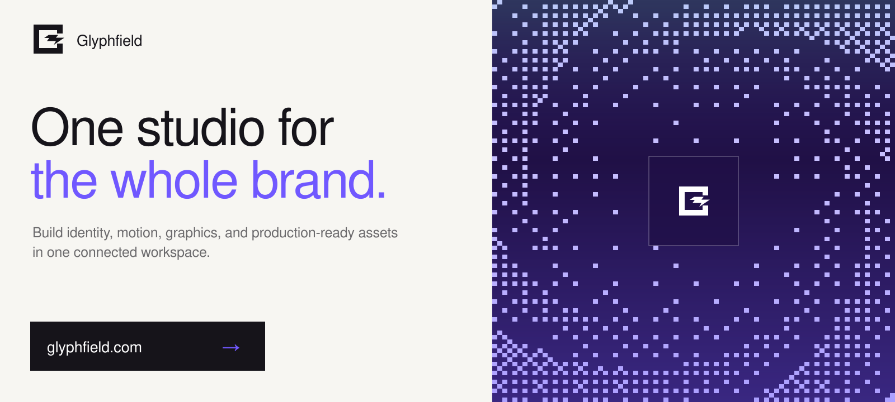
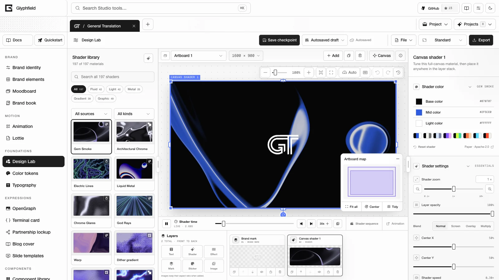

<p align="center">
  <a href="https://www.glyphfield.com/studio"></a>
</p>

# Glyphfield

Glyphfield is a free, open-source brand design studio that runs in your browser. You define a brand identity once, and every tool in the Studio uses it to make graphics, animations, templates, design tokens and a brand book.

[Open the Studio](https://www.glyphfield.com/studio) · [Documentation](https://www.glyphfield.com/docs) · [MIT License](./LICENSE)



A brand identity is one structured record. It holds the brand's name, logos, fonts, color palette, typography roles, voice, strategy and graphic device. Glyphfield is local-first: projects, uploaded files and saved designs are stored in your browser with localStorage and IndexedDB, and the Studio needs no account. The HTTP API processes generation requests in memory and does not store them.

## Try it

Open [www.glyphfield.com/studio](https://www.glyphfield.com/studio) in a desktop browser. To run it on your own machine, install Node.js 22.13 or later and run these commands:

```bash
git clone https://github.com/Kevin-Liu-01/Glyphfield.git
cd Glyphfield
corepack enable
pnpm install
pnpm dev
```

Then open <http://localhost:3012/studio>. The documentation is at <http://localhost:3012/docs>.

## Studio tools

The Studio has 15 tools in five categories. `GET /api/labs` returns the current list with each tool's Browser API actions and export formats.

| Tool | Category | What it does | Exports |
| --- | --- | --- | --- |
| Brand identity | Brand | Edits the shared identity and its logo and font files. An 11-section brand health audit scores the identity and offers one-click fixes. | Identity JSON; a brand kit ZIP with `brand.md`, DTCG tokens, CSS variables, a Tailwind v4 theme, logos and redistributable fonts |
| Brand elements | Brand | Applies the identity to 89 templates for email, product UI, developer, social, editorial, event and physical use. | PNG at each template's pixel size, send-ready HTML email, JSON brief |
| Moodboard | Brand | Lays the identity out as editable tile boards. | PNG, SVG, identity JSON |
| Brand book | Brand | Builds an editorial standards book with 16 × 10 in pages from the identity. | PDF through the browser's print dialog |
| Animation | Motion | Sequences text, logo and image scenes with keyframes, text entrances, captions, transitions, shader backgrounds and audio. | GIF, MP4 with audio, PNG poster frame, JSON project |
| Lottie | Motion | Imports, edits, recolors, trims and plays Lottie JSON and `.lottie` files. | PNG frame, GIF, MP4, JSON or `.lottie` |
| Design Lab | Foundations | Composes text, marks, images, stickers, live shaders and Effect layers on artboards in an open canvas. | PNG, JPG, GIF, MP4, JSON project |
| Color tokens | Foundations | Edits OKLCH color scales, semantic roles for light and dark mode, contrast pairs and color vision checks. | OKLCH CSS, CSS variables, Tailwind v4 theme, DTCG tokens |
| Typography | Foundations | Edits the type roles, the modular type scale and variable font axes. | CSS, Tailwind v4 or DTCG type tokens |
| OpenGraph | Expressions | Composes social preview images. | PNG, SVG |
| Terminal card | Expressions | Renders syntax-highlighted code cards. | PNG, SVG |
| Partnership lockup | Expressions | Places the brand's logo next to a partner's logo. | PNG, SVG |
| Blog cover | Expressions | Creates editorial cover images. | PNG, SVG |
| Slide templates | Expressions | Builds slide decks from 14 layouts. | PNG, SVG, PDF deck |
| Component library | Components | Renders 36 interface components in 10 families from the brand tokens, in light and dark mode. | React and Tailwind code, or HTML and CSS |

Every tool also has a source view. **File → Edit source code** opens the tool's state as JSON, and an edit there updates the same state as the visual controls. The five Expressions tools share one layered editor, and `POST /api/generate` renders the same templates as SVG.

The header button labeled **Visual customization** opens **Visual settings**, which control the Studio interface itself. They set the theme, the accent color, the canvas pattern, the corner shape, the interface font, compact density, reduced motion and tooltips. The accent can be one of the presets or a custom color.

## Shader library

Design Lab and Animation share one shader library. A shader is a live GPU-rendered material that can fill a layer or a background. `GET /api/materials` returns every material with its engine, source link, controls and motion support. On 2026-10-14 it listed 197 materials from these engines:

| Engine | Source | License |
| --- | --- | --- |
| Paper Shaders | [`@paper-design/shaders-react`](https://github.com/paper-design/shaders) 0.0.78 | Apache-2.0 |
| Shaders.com WebGPU | [`shaders`](https://github.com/shader-effects-inc/shaders) 4.0.1 | MIT |
| Glyphfield | Original GLSL and Canvas 2D materials in this repository | MIT |
| Shaders.com studies and design studies | Original GLSL materials in this repository, modeled on public visual references | MIT |
| WebGL Fluid | Adapted from [WebGL Fluid Simulation](https://github.com/PavelDoGreat/WebGL-Fluid-Simulation) by Pavel Dobryakov | MIT |
| HoloCloth | Adapted from [HoloCloth](https://github.com/dmitrykurash/holocloth) by Dmitry Kurash | MIT |
| ShaderGradient | [`@shadergradient/react`](https://github.com/ruucm/shadergradient) 2.4.20 | MIT |

The library leaves out shape primitives, plain fills and raw noise patterns. Saved documents that use one of those materials still load it. Design Lab also has Effect layers, which process every layer beneath them. An Effect layer runs a built-in Bayer, ASCII, halftone or posterize converter, or one of the Shaders.com image effects that `GET /api/materials` lists under `imageEffects`.

Shaders.com materials and image effects need WebGPU. In a browser without WebGPU, the library shows a still preview of those materials and their exports fail with an error.

## Reference identities

The Studio ships with a Starter template and eight complete example identities: Basement, General Translation, Ramp, Mintlify, Tailwind CSS, Vite+, Cloudflare and Stripe. Each example records the brand's strategy, voice, colors, typography, graphic device and applications, and it uses the brand's own published logos and media. `GET /api/identities` returns them.

The General Translation identity was rebuilt on 2026-10-13 from General Translation's own brand system. Its image library holds GT's marks and artwork and ten dithered pictures of public-domain and CC BY-SA 4.0 originals. Each picture keeps its original's license and credit, which [Third-party notices](./THIRD_PARTY_NOTICES.md#general-translation-artifact-pictures) lists.

## Agents

Every Glyphfield deployment serves these files and routes for AI agents. They describe the same tools, identities and formats as the Studio.

| Resource | Contents |
| --- | --- |
| [`/llms.txt`](https://www.glyphfield.com/llms.txt) | A short operating guide that routes an agent to the right interface |
| [`/llms-full.txt`](https://www.glyphfield.com/llms-full.txt) | The complete documentation as one text file |
| `/docs/<page>.md` | Any documentation page as Markdown |
| [`/openapi.json`](https://www.glyphfield.com/openapi.json) | An OpenAPI 3.1 description of every API route |
| [`/api/agent`](https://www.glyphfield.com/api/agent) | The agent manifest: interfaces, policies, resources, generation kinds and Browser API contracts |
| `/api/labs`, `/api/materials`, `/api/identities`, `/api/elements`, `/api/catalog` | Live catalogs of tools, shaders, identities and brand elements |
| `/api/brand/validate`, `/api/brand/kit` | The identity JSON Schema, stateless validation and brand kit files |

`POST /api/generate` makes deterministic output without a browser. It accepts four kinds: `background` (an SVG gradient, pattern, dither or surface), `template` (an OpenGraph, terminal card, slide, blog cover or partnership SVG), `element-brief` (one brand element resolved against an identity) and `design-sequence` (a Design Lab document to apply in the Studio). It rejects unknown fields and never fetches remote URLs.

```bash
curl -sS -X POST https://www.glyphfield.com/api/generate \
  -H 'Content-Type: application/json' \
  -d '{
    "kind": "template",
    "template": "slides",
    "identity": { "preset": "gt" },
    "slideLayout": "title",
    "title": "Code is the source of truth.",
    "output": "raw"
  }' \
  -o gt-slide.svg
```

Inside `/studio`, the Browser API at `window.glyphfield.studio` operates the open tool. It lists controls by accessible label, reads and applies exact source, and returns real browser-rendered files as Blobs. Use it for anything that depends on Canvas, WebGL, local fonts or local files.

```js
// Run in Design Lab: /studio?tool=material
const studio = window.glyphfield.studio;
console.log(studio.activeTool(), studio.describe().actions);
const artifact = await studio.invoke('design.export', { format: 'png', download: false });
console.log(artifact.fileName, artifact.blob.type, artifact.width, artifact.height);
```

The [`skills/`](./skills) directory holds five Agent Skills. An Agent Skill is a folder with a `SKILL.md` file that tells a coding agent how to do one task with Glyphfield:

| Skill | Task |
| --- | --- |
| [`glyphfield-brand`](./skills/glyphfield-brand/SKILL.md) | Set up or improve a brand identity from the brand's own website, repository or files, then audit it and export the brand kit |
| [`glyphfield-create`](./skills/glyphfield-create/SKILL.md) | Build or revise a layered Design Lab composition |
| [`glyphfield-api`](./skills/glyphfield-api/SKILL.md) | Discover the HTTP API and generate output without a browser |
| [`glyphfield-studio`](./skills/glyphfield-studio/SKILL.md) | Operate the live Studio through the Browser API |
| [`glyphfield-export`](./skills/glyphfield-export/SKILL.md) | Export still and motion files and verify them |

The [agent connection guide](https://www.glyphfield.com/docs/agents/connect) explains how to choose between HTTP and the Browser API.

## Development

The repository is a Next.js 16 App Router application with React 19 and strict TypeScript. It uses pnpm 11.15.1, which `packageManager` in `package.json` pins. `package.json` declares no `engines` field. pnpm 11.15.1 requires Node.js 22.13 or later. pnpm 10 cannot install the lockfile with `--frozen-lockfile` because of its patched dependencies.

| Command | Purpose |
| --- | --- |
| `pnpm install` | Install dependencies. Run `corepack enable` first so the pinned pnpm version is used. |
| `pnpm dev` | Start the development server with Turbopack on port 3012. |
| `pnpm test` | Run the Vitest unit tests once. |
| `pnpm lint` | Run oxlint, then the ESLint complexity rules. |
| `pnpm typecheck` | Generate the Fumadocs content and run the TypeScript checker. |
| `pnpm build` | Build for production with Turbopack. |
| `pnpm start` | Serve the production build. |
| `pnpm test:browsers` | Run the Playwright tests in Chromium, WebKit and Firefox against a running server, by default `http://localhost:3014`. Install the browsers first with `pnpm exec playwright install chromium webkit firefox`. |

`package.json` lists the remaining scripts. They check shader pixels, shader frame rates, interaction performance, text export and native Safari behavior.

The application reads one environment variable. `NEXT_PUBLIC_STUDIO_URL` sets the public origin used in canonical URLs, OpenGraph metadata, the sitemap and `robots.txt`. When it is unset or empty, `src/lib/seo.ts` uses `https://www.glyphfield.com`, so set it for a self-hosted deployment. The test scripts read their own variables, such as `GLYPHFIELD_BROWSER_BASE_URL` for Playwright and `GLYPHFIELD_SHADER_BASE_URL` for the shader checks. No API keys are needed.

## Project structure

```text
src/app/          Next.js routes: landing page, /studio, /docs, API routes, llms-full.txt, openapi.json
src/components/   Studio tool editors, canvas and shader renderers, landing and docs components
src/hooks/        React state hooks for persistence and performance-sensitive editors
src/lib/          Identity model, catalogs, renderers, exporters and agent contracts
content/docs/     Fumadocs MDX source for /docs
public/           Fonts, brand assets, reference identity media, llms.txt and shader previews
skills/           Agent Skills for operating Glyphfield
e2e/              Playwright browser tests
scripts/          Browser checks for shaders, performance, Safari and text export
docs/             Engineering notes and audits
```

## Contributing

Read the [contributing guide](https://www.glyphfield.com/docs/contributing) before opening a pull request. A change to a Studio tool must also update its source format, its Browser API actions, the agent manifest, the documentation and the tests. [`AGENTS.md`](./AGENTS.md) lists that chain and the main files for coding agents.

## Recent changes

- 2026-10-14: The Glyphfield mark is redrawn as a closed G with a lightning-bolt crossbar.
- 2026-10-14: Visual settings gained a custom accent color and a switch that turns tooltips off.
- 2026-10-14: The bundled Inter font is Inter Variable 4.1 by Rasmus Andersson, with its optical-size axis and all OpenType features. Identities that use Inter and the SVGs from `POST /api/generate` use it. The previous file was a stripped Latin subset.
- 2026-10-13: The shader library dropped shape primitives, plain fills and raw noise, and a replacement shader now loads while the previous one stays on screen.
- 2026-10-13: The General Translation identity was rebuilt from GT's brand system with credited artwork.
- 2026-10-13 and 2026-10-14: The landing page, `/studio` and `/docs` are prerendered as static HTML. The landing page loads the hero editor's code separately from its own code and hydrates the demos below the hero as they near the viewport. Studio-only CSS loads only on `/studio`, and switching tools or projects in the Studio no longer shows a blank pane.

## License

Glyphfield's source code and original Glyphfield artwork, including the Starter identity, are released under the [MIT License](./LICENSE). The license does not cover the assets bundled with the reference identities:

- Brand marks, product media and press-kit files under `public/brands` belong to their owners. General Translation's marks and brand-system artwork are © General Translation, Inc. and are included with permission for its identity. [Brand research assets](./public/brands/ASSET-NOTICE.md) lists the sources.
- The ten artifact pictures in the General Translation library keep their originals' licenses. Seven are public domain and three are CC BY-SA 4.0.
- Reference-brand font files keep their foundries' terms. [`public/fonts/brands/README.md`](./public/fonts/brands/README.md) lists them.

[Third-party notices](./THIRD_PARTY_NOTICES.md) credits the open-source code and fonts that Glyphfield includes or adapts. Including a brand's assets does not imply that brand's endorsement, and the MIT License grants no rights to third-party trademarks.
